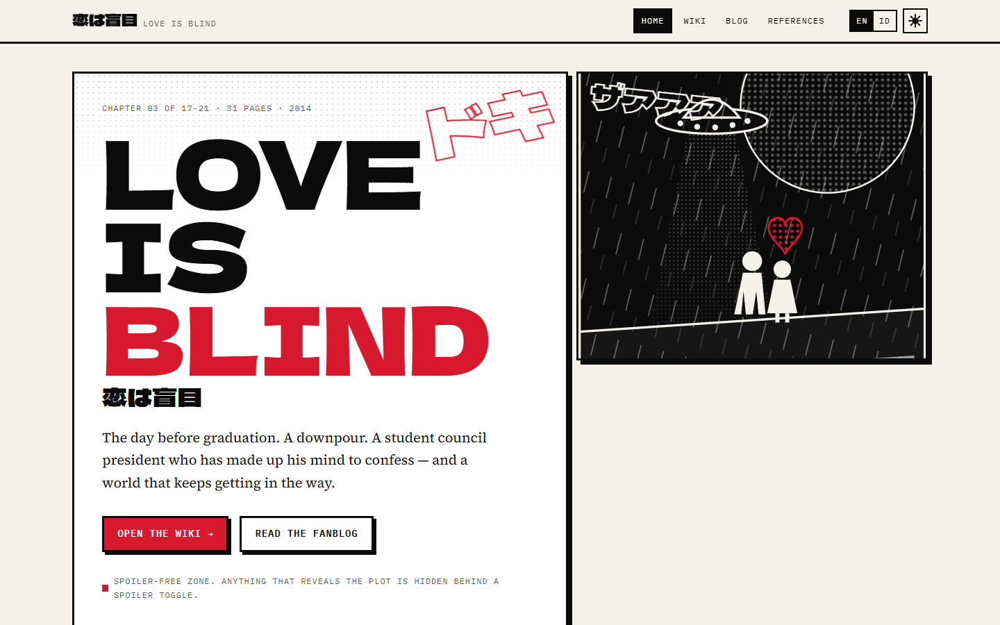
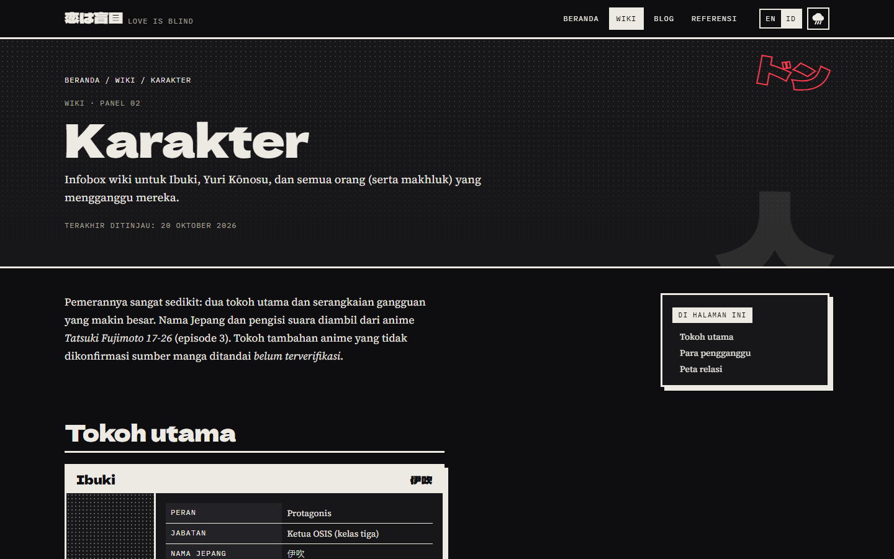
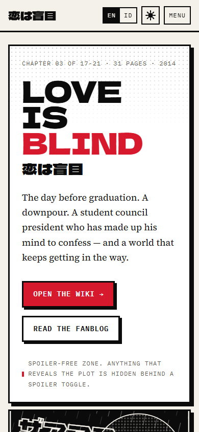

# 恋は盲目 · Love is Blind — Fan Wiki

**Live:** https://dans-vsa.github.io/love-is-blind-fanwiki/

A fan-made, bilingual (EN / ID) semi-wiki and fanblog for **_Love is Blind_ (恋は盲目, Koi wa Mōmoku)**, the 31-page debut one-shot by **Tatsuki Fujimoto**. It won an honorable mention at the 9th Crown Newcomer Manga Award (2013), was published in *Jump SQ.19* Vol. 13 (2014), and is collected in *17-21* (VIZ: *Tatsuki Fujimoto Before Chainsaw Man: 17-21*).

The design takes its cue from the manga itself: black ink on newsprint, screentone halftone, thick panel gutters, diagonal downpour lines, speech-bubble quotes, onomatopoeia, and **one red accent** reserved for the confession.

> Fan-made and non-commercial. *Love is Blind*, its characters and artwork are © Tatsuki Fujimoto / Shueisha. No manga pages are reproduced. See [CREDITS.md](CREDITS.md).

| Home (day page) | Wiki, Indonesian, night-downpour mode | Mobile |
| --- | --- | --- |
|  |  |  |

## Features

- **Semi-wiki**: Synopsis, Characters (wiki infoboxes), Themes & Analysis, Setting, Timeline, Publication & Anime, Trivia, About the Mangaka, Gallery.
- **Fanblog**: 3 starter articles (review, theme essay, comparison with Fujimoto's other works), written in MDX.
- **Spoiler protection**: `<Spoiler>` blocks are blurred and `inert` until "Show spoiler / Tampilkan spoiler" is pressed. Spoilers are stripped from the search index too.
- **EN / ID i18n**: `/en/…` and `/id/…` URLs. The navbar toggle keeps you on the same page and saves your choice in `localStorage`. `/` picks saved choice → browser language → English. All UI, wiki and blog content exists in both languages.
- **Client-side search** across wiki and blog (JSON index generated at build time).
- **Sticky TOC** with active-section highlight on every article.
- **Dark / light mode** ("day page" / "night downpour"), stored in `localStorage`, defaults to `prefers-color-scheme`, no flash.
- **Panel-reveal animation** using CSS scroll-driven animations. It degrades to static where unsupported, and all motion is disabled under `prefers-reduced-motion`.
- **SEO**: meta + Open Graph + Twitter cards, `hreflang` alternates, canonical URLs, `sitemap-index.xml`, `robots.txt`, favicon set.
- **Accessibility**: skip link, landmarks, keyboard-operable toggles, `aria-expanded` / `aria-current`, alt text, AA contrast in both themes.
- **Performance**: zero framework JS, inlined CSS, trimmed font subsets with preloads, AVIF/WebP images with lazy loading. Lighthouse (mobile, local): Performance 93–97, Accessibility / Best Practices / SEO 100.

## Tech stack and why

| | |
| --- | --- |
| [Astro 7](https://astro.build) | Content-first static site generator. It ships zero JS by default, has typed **content collections** for Markdown/MDX, and outputs static HTML for Vercel or GitHub Pages. A better fit than a Next.js static export for a mostly-text wiki. |
| Tailwind CSS 4 | Utility styling on top of the custom design tokens in `src/styles/global.css` (see `DESIGN.md`). |
| TypeScript (strict) | Typed content schemas, i18n keys and data files. |
| MDX | Articles can use components (`<Spoiler>`, `<SpeechBubble>`, `<Infobox>`). |
| Fontsource | Self-hosted Google Fonts (Dela Gothic One, Source Serif 4, IBM Plex Mono). |

## Run locally

Requires Node.js ≥ 22.

```bash
npm install
npm run dev        # http://localhost:4321
npm run build      # static output in dist/
npm run preview    # serve dist/
npm run verify     # astro check + eslint + build + internal link/asset check
```

## Project structure

```text
.
├── DESIGN.md                 # design system (tokens, components, do's & don'ts)
├── CREDITS.md                # asset sources & licences
├── public/
│   ├── assets/img/           # cover + photo (AVIF/WebP), assets/og/ (Open Graph image)
│   └── favicon.svg / .ico, apple-touch-icon.png
├── scripts/
│   ├── optimize-images.mjs   # convert/resize images to AVIF + WebP
│   ├── generate-icons.mjs    # favicon.ico, touch icon, OG image from SVG
│   ├── build-fonts.mjs       # trims @font-face to used subsets → src/styles/fonts.css
│   └── check-links.mjs       # verifies every internal href/src in dist/
└── src/
    ├── content/
    │   ├── wiki/{en,id}/*.mdx
    │   └── blog/{en,id}/*.mdx
    ├── content.config.ts     # collection schemas
    ├── data/                 # characters.ts, sources.ts, credits.ts
    ├── i18n/                 # en.json, id.json, helpers
    ├── components/           # Nav, Footer, Spoiler, SpeechBubble, Sfx, Infobox, Toc, SearchBox, Gallery…
    ├── layouts/              # Base.astro (SEO, theme), Article.astro (TOC layout)
    ├── lib/content.ts        # collection helpers, search text
    ├── pages/
    │   ├── index.astro       # language-detecting redirect
    │   ├── 404.astro, robots.txt.ts
    │   └── [lang]/           # home, wiki/, blog/, references, search-index.json
    └── styles/               # global.css (theme), fonts.css (generated)
```

## Adding content

### A new blog article

Create the same slug in both language folders:

```text
src/content/blog/en/my-post.mdx
src/content/blog/id/my-post.mdx
```

```mdx
---
title: My post
description: One-sentence summary used for cards and SEO.
date: 2026-11-01
tags: [essay]
sfx: ドン          # decorative onomatopoeia on the card
spoilers: false    # true shows a spoiler badge
---
import Spoiler from '../../../components/Spoiler.astro';

## A heading (appears in the TOC)

<Spoiler lang="en" title="The ending">
Hidden until the reader opts in.
</Spoiler>
```

### A new wiki page

Same idea in `src/content/wiki/{en,id}/`. Frontmatter: `title`, `description`, `order` (card position), `kanji` (decorative glyph), `spoilers`, `sources` (ids from `src/data/sources.ts`, listed at the bottom of the page) and `updated`. Mark doubtful claims with `<Unverified lang="en" />`.

If you add new Japanese characters to display text, run `npm run fonts` so the display font includes them.

### A new language

1. Add the code to `locales` in `src/i18n/index.ts` and create `src/i18n/<code>.json` (copy `en.json`).
2. Add `src/content/{wiki,blog}/<code>/` with translated files.
3. Add the locale to the sitemap `i18n.locales` in `astro.config.mjs`, and extend the language-detection regex in `src/pages/index.astro`.
4. Translate the `L` fields in `src/data/characters.ts`.

## Deploy

- **GitHub Pages (current)**: `.github/workflows/deploy.yml` builds and deploys on every push to `main`, using `withastro/action` and `actions/deploy-pages`. It sets `SITE=https://dans-vsa.github.io` and `BASE=/love-is-blind-fanwiki`, then runs the link checker before publishing. You can also run it manually from the Actions tab.
- **Vercel (alternative)**: import the repo (the Astro preset is auto-detected), set `SITE` to the production URL and leave `BASE` unset.

## Sources and accuracy

Every fact links back to a source on the References page (`/en/references/`). Claims that rely on a single or fan-edited source are flagged *unverified*. Corrections are welcome.

## License

- Code: MIT.
- Original text and illustrations: CC BY 4.0.
- Third-party assets keep their own licences (see [CREDITS.md](CREDITS.md)).
